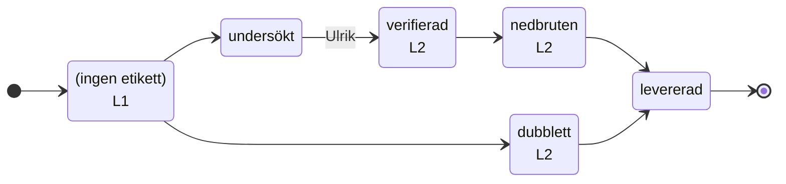

<!-- GENERERAD av `bun run flow:gen` ur tooling/agents/flow.yaml — redigera inte för hand. -->
# Agentkedjans flöde

Varje sak har exakt ett tillstånd (en etikett). Flödesvakten
(`.github/workflows/agent-flow.yml`) stoppar otillåtna övergångar, tar bort det
gamla tillståndet och sköter timeouterna. Flaggor läggs ovanpå tillståndet.
CI som hänger mer än 60 minuter avbryts.

## intake (`ulrik-s/ava-feedback`, issues)

En förfrågan från knappen i AVA.



| Tillstånd | Etikett | Agent | Får gå till | Timeout |
|---|---|---|---|---|
| mottagen | — | L1 | undersokt, dubblett | — |
| undersokt | `undersökt` | — | verifierad (Ulrik) | — |
| verifierad | `verifierad` | L2 | nedbruten | — |
| nedbruten | `nedbruten` | L2 | levererad | — |
| levererad | `levererad` | — | — | — |
| dubblett | `dubblett` | L2 | levererad | — |

| Flagga | Får sättas av | Timeout | Betyder |
|---|---|---|---|
| `user-request` | alla | — | Från knappen i AVA — användarens egen text |
| `bugg` | alla | — | Användaren rapporterar ett fel |
| `förslag` | alla | — | Användaren föreslår en förbättring |
| `ej-bekräftad` | alla | — | Verifieringsagenten kunde inte bekräfta buggen/behovet |
| `väntar-på-användaren` | alla | 7 d → tas bort | En fråga till användaren (i AVA) väntar på svar |
| `blockerad` | alla | — | Agenten behöver ett beslut av Ulrik |

## code-issue (`ulrik-s/ava`, issues)

En implementations-issue (eller ett refaktoriseringsförslag) i ava.

```mermaid
stateDiagram-v2
  direction LR
  state "(ingen etikett)" as ny
  state "att-granska<br/>L3" as att-granska
  state "behöver-ändras<br/>L3" as behover-andras
  state "granskad<br/>L4" as granskad
  state "pågår<br/>L4" as pagar
  [*] --> ny
  ny --> att-granska
  ny --> granskad : Ulrik
  att-granska --> granskad : Ulrik om refaktorisering
  att-granska --> behover-andras
  behover-andras --> att-granska
  granskad --> pagar
  granskad --> att-granska
  pagar --> granskad
  pagar --> att-granska
  pagar --> granskad : timeout 4 h
```

| Tillstånd | Etikett | Agent | Får gå till | Timeout |
|---|---|---|---|---|
| ny | — | — | att-granska, granskad (Ulrik) | — |
| att-granska | `att-granska` | L3 | granskad, behover-andras | — |
| behover-andras | `behöver-ändras` | L3 | att-granska | — |
| granskad | `granskad` | L4 | pagar, att-granska | — |
| pagar | `pågår` | L4 | granskad, att-granska | 4 h → granskad |

| Flagga | Får sättas av | Timeout | Betyder |
|---|---|---|---|
| `agent-task` | alla | — | Implementations-issue skapad av nedbrytningsloopen |
| `refaktorisering` | alla | — | Förslag från arkitekturgenomgången — byggs först när Ulrik satt granskad |
| `arkitektur-rapport` | alla | — | Veckans arkitekturgenomgång (loop 5) |
| `blockerad` | alla | — | Agenten behöver ett beslut av Ulrik |

## code-pr (`ulrik-s/ava`, pulls)

En PR i ava — agentens egen, Dependabots eller Ulriks.

```mermaid
stateDiagram-v2
  direction LR
  state "(ingen etikett)<br/>L6" as ny
  state "att-granska<br/>L3" as att-granska
  state "behöver-ändras<br/>L4" as behover-andras
  state "granskad<br/>L3" as granskad
  [*] --> ny
  ny --> att-granska
  ny --> granskad
  ny --> behover-andras
  att-granska --> granskad
  att-granska --> behover-andras
  behover-andras --> att-granska
  behover-andras --> granskad
  granskad --> att-granska
  granskad --> behover-andras
```

| Tillstånd | Etikett | Agent | Får gå till | Timeout |
|---|---|---|---|---|
| ny | — | L6 | att-granska, granskad, behover-andras | — |
| att-granska | `att-granska` | L3 | granskad, behover-andras | — |
| behover-andras | `behöver-ändras` | L4 | att-granska, granskad | — |
| granskad | `granskad` | L3 | att-granska, behover-andras | — |

| Flagga | Får sättas av | Timeout | Betyder |
|---|---|---|---|
| `agent-pr` | alla | — | PR skapad av implementationsloopen |
| `människa-godkänd` | Ulrik | — | Ulrik tillåter att agent-PR:en rör skyddade sökvägar/migrationer |
| `blockerad` | alla | — | Agenten behöver ett beslut av Ulrik |

## Rutiner

| Id | Rutin | Prompt | Startas av |
|---|---|---|---|
| L1 | AVA - 1 - Verification - User Feedback | `tooling/agents/1-verifiering.md` | `ava-feedback issues.opened`<br>`ava-feedback issue_comment.created` |
| L2 | AVA - 2 - Breakdown - User Feedback | `tooling/agents/2-nedbrytning.md` | `ava-feedback issues.labeled verifierad`<br>`ava release.published` |
| L3 | AVA - 3 - Review - User Feedback | `tooling/agents/3-granskning.md` | `ava issues.labeled att-granska`<br>`ava pull_request.labeled att-granska`<br>`ava check_suite.completed` |
| L4 | AVA - 4 - Implementation - User Feedback | `tooling/agents/4-implementation.md` | `ava issues.labeled granskad`<br>`ava pull_request.labeled behöver-ändras` |
| L5 | AVA - 5 - Architecture - Weekly | `tooling/agents/5-arkitektur.md` | — |
| L6 | AVA - 6 - PR-vakt | `tooling/agents/6-pr-vakt.md` | `ava pull_request.opened`<br>`ava workflow_run.completed` |
