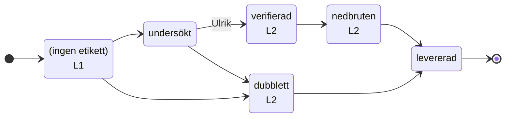

<!-- GENERERAD av `bun run flow:gen` ur tooling/agents/flow.yaml — redigera inte för hand. -->
# Agentkedjans flöde

Varje sak har exakt ett tillstånd (en etikett). Flödesvakten
(`.github/workflows/agent-flow.yml`) stoppar otillåtna övergångar, tar bort det
gamla tillståndet och sköter timeouterna. Flaggor läggs ovanpå tillståndet.
CI som hänger mer än 60 minuter avbryts. Står en sak längre än 2h
i ett tillstånd med en agent startas agenten igen (knuffen), utom med `blockerad` eller `väntar-på-användaren`.

## intake (`ulrik-s/ava-feedback`, issues)

En förfrågan från knappen i AVA.



| Tillstånd | Etikett | Agent | Får gå till | Timeout |
|---|---|---|---|---|
| mottagen | — | L1 | undersokt, dubblett | — |
| undersokt | `undersökt` | — | verifierad (Ulrik), dubblett | — |
| verifierad | `verifierad` | L2 | nedbruten | — |
| nedbruten | `nedbruten` | L2 | levererad | — |
| levererad | `levererad` | — | — | — |
| dubblett | `dubblett` | L2 | levererad | — |

| Flagga | Får sättas av | Timeout | Betyder |
|---|---|---|---|
| `user-request` | alla | — | Från knappen i AVA — användarens egen text |
| `bugg` | alla | — | Användaren rapporterar ett fel |
| `förslag` | alla | — | Användaren föreslår en förbättring |
| `ej-bekräftad` | alla | — | Verifieringsagenten kunde inte bekräfta buggen/behovet |
| `väntar-på-användaren` | alla | 7 d → tas bort | En fråga till användaren (i AVA) väntar på svar |
| `blockerad` | alla | — | Agenten behöver ett beslut av Ulrik |
| `agentstatus` | alla | — | Statussidan för agentkedjan (uppdateras av flödesvakten) |

## code-issue (`ulrik-s/ava`, issues)

En implementations-issue (eller ett refaktoriseringsförslag) i ava.

```mermaid
stateDiagram-v2
  direction LR
  state "(ingen etikett)" as ny
  state "att-granska<br/>L3" as att-granska
  state "behöver-ändras<br/>L3" as behover-andras
  state "granskad<br/>L4" as granskad
  state "pågår<br/>L4" as pagar
  [*] --> ny
  ny --> att-granska
  ny --> granskad : Ulrik
  att-granska --> granskad : Ulrik om refaktorisering
  att-granska --> behover-andras
  behover-andras --> att-granska
  granskad --> pagar
  granskad --> att-granska
  pagar --> granskad
  pagar --> att-granska
  pagar --> granskad : timeout 4 h
```

| Tillstånd | Etikett | Agent | Får gå till | Timeout |
|---|---|---|---|---|
| ny | — | — | att-granska, granskad (Ulrik) | — |
| att-granska | `att-granska` | L3 | granskad, behover-andras | — |
| behover-andras | `behöver-ändras` | L3 | att-granska | — |
| granskad | `granskad` | L4 | pagar, att-granska | — |
| pagar | `pågår` | L4 | granskad, att-granska | 4 h → granskad |

| Flagga | Får sättas av | Timeout | Betyder |
|---|---|---|---|
| `agent-task` | alla | — | Implementations-issue skapad av nedbrytningsloopen |
| `refaktorisering` | alla | — | Förslag från arkitekturgenomgången — byggs först när Ulrik satt granskad |
| `arkitektur-rapport` | alla | — | Veckans arkitekturgenomgång (loop 5) |
| `blockerad` | alla | — | Agenten behöver ett beslut av Ulrik |

## code-pr (`ulrik-s/ava`, pulls)

En PR i ava — agentens egen, Dependabots eller Ulriks.

```mermaid
stateDiagram-v2
  direction LR
  state "(ingen etikett)<br/>L6" as ny
  state "att-granska<br/>L3" as att-granska
  state "behöver-ändras<br/>L4" as behover-andras
  state "granskad<br/>L3" as granskad
  [*] --> ny
  ny --> att-granska
  ny --> granskad
  ny --> behover-andras
  att-granska --> granskad
  att-granska --> behover-andras
  behover-andras --> att-granska
  behover-andras --> granskad
  granskad --> att-granska
  granskad --> behover-andras
```

| Tillstånd | Etikett | Agent | Får gå till | Timeout |
|---|---|---|---|---|
| ny | — | L6 | att-granska, granskad, behover-andras | — |
| att-granska | `att-granska` | L3 | granskad, behover-andras | — |
| behover-andras | `behöver-ändras` | L4 | att-granska, granskad | — |
| granskad | `granskad` | L3 | att-granska, behover-andras | — |

| Flagga | Får sättas av | Timeout | Betyder |
|---|---|---|---|
| `agent-pr` | alla | — | PR skapad av implementationsloopen |
| `människa-godkänd` | Ulrik | — | Ulrik tillåter att agent-PR:en rör skyddade sökvägar/migrationer |
| `blockerad` | alla | — | Agenten behöver ett beslut av Ulrik |

## Förhandsgodkända skrivningar

Agenterna skriver till GitHub med EXAKT de här formerna (N = numret, en etikett per kommando, inga
`--jq` eller `$(…)`). De är förhandsgodkända i `.claude/settings.json`, som ett test håller lika med
den här listan. `verifierad` och `människa-godkänd` sätter bara Ulrik.

```bash
gh api -X DELETE repos/ulrik-s/ava-feedback/issues/N/labels/agentstatus
gh api -X DELETE repos/ulrik-s/ava-feedback/issues/N/labels/blockerad
gh api -X DELETE repos/ulrik-s/ava-feedback/issues/N/labels/bugg
gh api -X DELETE repos/ulrik-s/ava-feedback/issues/N/labels/dubblett
gh api -X DELETE repos/ulrik-s/ava-feedback/issues/N/labels/ej-bekr%C3%A4ftad
gh api -X DELETE repos/ulrik-s/ava-feedback/issues/N/labels/f%C3%B6rslag
gh api -X DELETE repos/ulrik-s/ava-feedback/issues/N/labels/levererad
gh api -X DELETE repos/ulrik-s/ava-feedback/issues/N/labels/nedbruten
gh api -X DELETE repos/ulrik-s/ava-feedback/issues/N/labels/unders%C3%B6kt
gh api -X DELETE repos/ulrik-s/ava-feedback/issues/N/labels/user-request
gh api -X DELETE repos/ulrik-s/ava-feedback/issues/N/labels/v%C3%A4ntar-p%C3%A5-anv%C3%A4ndaren
gh api -X DELETE repos/ulrik-s/ava-feedback/issues/N/labels/verifierad
gh api -X DELETE repos/ulrik-s/ava/issues/N/labels/agent-pr
gh api -X DELETE repos/ulrik-s/ava/issues/N/labels/agent-task
gh api -X DELETE repos/ulrik-s/ava/issues/N/labels/arkitektur-rapport
gh api -X DELETE repos/ulrik-s/ava/issues/N/labels/att-granska
gh api -X DELETE repos/ulrik-s/ava/issues/N/labels/beh%C3%B6ver-%C3%A4ndras
gh api -X DELETE repos/ulrik-s/ava/issues/N/labels/blockerad
gh api -X DELETE repos/ulrik-s/ava/issues/N/labels/granskad
gh api -X DELETE repos/ulrik-s/ava/issues/N/labels/p%C3%A5g%C3%A5r
gh api -X DELETE repos/ulrik-s/ava/issues/N/labels/refaktorisering
gh api -X POST repos/ulrik-s/ava-feedback/actions/workflows/flodesvakt.yml/dispatches -f ref=main
gh api -X POST repos/ulrik-s/ava/actions/workflows/agent-flow.yml/dispatches -f ref=main
gh api -X PUT repos/ulrik-s/ava/pulls/N/merge -f merge_method=squash -f sha=*
gh api repos/ulrik-s/ava-feedback/issues/N/comments -F body=@*
gh api repos/ulrik-s/ava-feedback/issues/N/labels -f 'labels[]=agentstatus'
gh api repos/ulrik-s/ava-feedback/issues/N/labels -f 'labels[]=blockerad'
gh api repos/ulrik-s/ava-feedback/issues/N/labels -f 'labels[]=bugg'
gh api repos/ulrik-s/ava-feedback/issues/N/labels -f 'labels[]=dubblett'
gh api repos/ulrik-s/ava-feedback/issues/N/labels -f 'labels[]=ej-bekräftad'
gh api repos/ulrik-s/ava-feedback/issues/N/labels -f 'labels[]=förslag'
gh api repos/ulrik-s/ava-feedback/issues/N/labels -f 'labels[]=levererad'
gh api repos/ulrik-s/ava-feedback/issues/N/labels -f 'labels[]=nedbruten'
gh api repos/ulrik-s/ava-feedback/issues/N/labels -f 'labels[]=release:v*'
gh api repos/ulrik-s/ava-feedback/issues/N/labels -f 'labels[]=undersökt'
gh api repos/ulrik-s/ava-feedback/issues/N/labels -f 'labels[]=user-request'
gh api repos/ulrik-s/ava-feedback/issues/N/labels -f 'labels[]=väntar-på-användaren'
gh api repos/ulrik-s/ava-feedback/labels -f name=release:v* -f color=0e8a16
gh api repos/ulrik-s/ava/issues/N/labels -f 'labels[]=agent-pr'
gh api repos/ulrik-s/ava/issues/N/labels -f 'labels[]=agent-task'
gh api repos/ulrik-s/ava/issues/N/labels -f 'labels[]=arkitektur-rapport'
gh api repos/ulrik-s/ava/issues/N/labels -f 'labels[]=att-granska'
gh api repos/ulrik-s/ava/issues/N/labels -f 'labels[]=behöver-ändras'
gh api repos/ulrik-s/ava/issues/N/labels -f 'labels[]=blockerad'
gh api repos/ulrik-s/ava/issues/N/labels -f 'labels[]=granskad'
gh api repos/ulrik-s/ava/issues/N/labels -f 'labels[]=pågår'
gh api repos/ulrik-s/ava/issues/N/labels -f 'labels[]=refaktorisering'
```

## Rutiner

| Id | Rutin | Prompt | Startas av (utöver schemat) |
|---|---|---|---|
| L1 | AVA - 1 - Verification - User Feedback | `tooling/agents/1-verifiering.md` | `GitHub: ava-feedback issues.opened` |
| L2 | AVA - 2 - Breakdown - User Feedback | `tooling/agents/2-nedbrytning.md` | `intake.verifierad`<br>`intake.dubblett`<br>`GitHub: ava release.published` |
| L3 | AVA - 3 - Review - User Feedback | `tooling/agents/3-granskning.md` | `code-issue.att-granska`<br>`code-issue.behover-andras`<br>`code-pr.att-granska`<br>`code-pr.granskad` |
| L4 | AVA - 4 - Implementation - User Feedback | `tooling/agents/4-implementation.md` | `code-issue.granskad`<br>`code-pr.behover-andras` |
| L5 | AVA - 5 - Architecture - Weekly | `tooling/agents/5-arkitektur.md` | — |
| L6 | AVA - 6 - PR-vakt | `tooling/agents/6-pr-vakt.md` | — |
